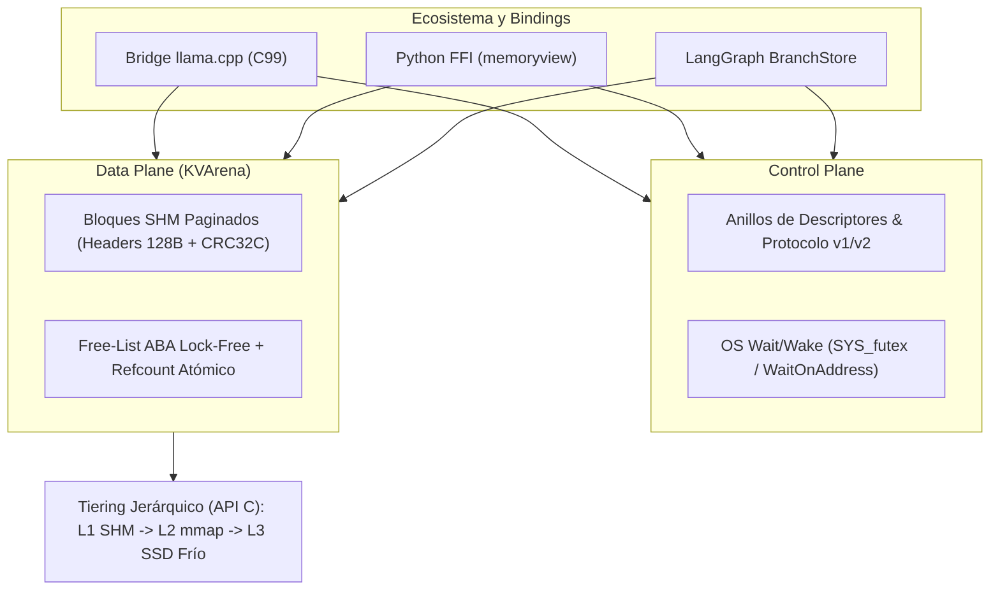

# Vect-Link

**Motor independiente en C99 para almacenamiento Copy-on-Write (CoW) de KV-cache e IPC en memoria compartida entre procesos compatibles de LLMs locales.**

> **Estado del Proyecto:** Implementado y verificado (`main`). Vect-Link ofrece almacenamiento paginado de KV en memoria compartida, ramificación `Snapshot / Fork / Restore` y transporte por anillo SPSC para procesos con modelos y entornos **compatibles**. **No** realiza traducción ni inyección de KV-cache entre arquitecturas distintas.

---

## 1. Arquitectura y Capacidades

Vect-Link separa el **Data Plane** (`KVArena` paginado con CoW en SHM) del **Control Plane** (anillos de descriptores y notificaciones nativas `SYS_futex` / `WaitOnAddress`):

- **Copy-on-Write y `KVArena` (`include/vectlink_kv.h`):** Fork en `~4,9–23,9 µs` duplicando únicamente `block_ids[]` y aumentando `refcount` atómico; soporta 1:N lectores concurrentes sobre bloques sellados.
- **Identidad estricta (`KVIdentity`):** Valida `token_prefix_hash`, `model_arch_hash`, `rope_config_hash`, `lora_adapter_hash`, `kv_dtype`, `layer_count`, `head_dim` y `kv_head_count`, rechazando cualquier restauración incompatible.
- **Persistencia y recuperación:** La API C implementa almacenamiento frío L3 en SSD con recuperación tras destrucción de SHM (`vtlk_tier_index.bin` + CRC32C); el binding Python `KVArena.create` expone actualmente solo SHM.
- **Alcance Zero-Copy:** Cero copias entre procesos y hasta la frontera de `llama_state_seq_set_data()`; internamente `llama.cpp` copia el estado restaurado al `llama_context` privado de cada worker.

---

## 2. Resultados y Limitaciones (Benchmarks Propios en CPU)

- **Multi-proceso `llama.cpp` (`N = 1..8`, `qwen2.5-0.5b-instruct-q4_k_m.gguf`, `242` tokens compartidos, `2,84 MiB` KV):**
  - TTFT medio **7,83×–9,27×** menor que Cold Prefill (`170,12 ms` vs `1.425,51 ms` en `N=1`; `476,97 ms` vs `3.734,32 ms` en `N=8`).
  - Frente a `llama_state_seq_load_file`: TTFT comparable (`~170–477 ms`), con fork de **`4,90–23,85 µs`** vs `3.080–8.923 µs` de carga desde archivo y almacenamiento único en SHM.
- **Validación bit-exact (`llama_kv_paged_bridge.c`):** `16/16` tokens idénticos y `max_logit_diff = 0.000000` en 3 ramas divergentes (`1.390.508 B`, `0` allocs en heap).

---

## 3. Integración Opcional con CMCP

Vect-Link es **100% independiente** de CMCP. Para transferir contexto semántico portable entre modelos heterogéneos con reutilización KV opcional cuando los modelos coinciden, consultar **[Cross-Model-Context-Protocol (CMCP)](https://github.com/Santirobm/Cross-Model-Context-Protocol)** y **[VectLink-CMCP](https://github.com/Santirobm/VectLink-CMCP)**.

---

## 4. Compilación, Tests y Licencia

- **English README (Primary):** [README.md](README.md)
- **Compilación y tests:** `cmake -B build -DCMAKE_BUILD_TYPE=Release && cmake --build build && ctest --test-dir build`, más `build-san` (ASan+UBSan) y `python -m unittest discover -s python/tests -v`.
- **Licencia:** Apache License 2.0 — [LICENSE](LICENSE).
