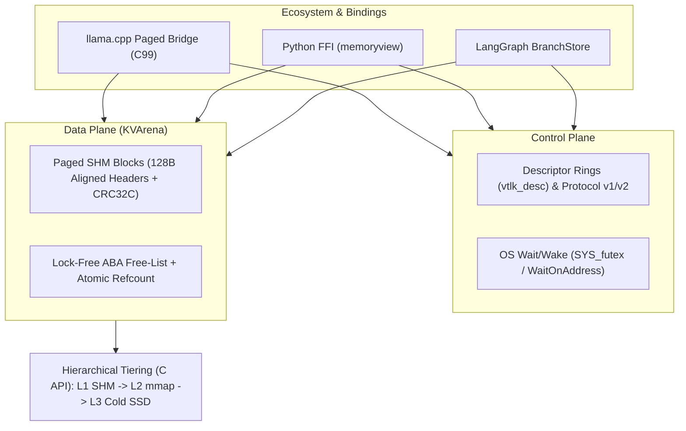

# Vect-Link

**Independent C99 Copy-on-Write (CoW) KV-cache store and shared-memory IPC engine for compatible local LLM processes.**

[](#building--testing)
[](#python-ffi--langgraph-integration)
[](#architecture)
[](#building--testing)

> **Project Status:** Implemented & verified (`main`). Vect-Link provides paged shared-memory KV storage, `Snapshot / Fork / Restore` branching, and SPSC ring transport for **compatible** model/runtime processes. It does **not** translate KV caches across different model architectures.

---

## 1. Architecture

Vect-Link separates the **Data Plane** (paged CoW shared-memory arena) from the **Control Plane** (compact descriptor rings and OS wait/wake notifications):



### Core Subsystems & Implemented Capabilities
| Subsystem | Capabilities Implemented | Scope / Notes |
|---|---|---|
| **CoW `KVArena` (`include/vectlink_kv.h`)** | Paged SHM blocks, `Snapshot / Fork / Restore`, lock-free ABA free-list, 1:N concurrent readers | Fork duplicates only `block_ids[]` (`~4.9–23.9 µs`) with atomic refcounting |
| **Strict Identity Contract (`KVIdentity`)** | Validates `token_prefix_hash`, `model_arch_hash`, `rope_config_hash`, `lora_adapter_hash`, `kv_dtype`, `layer_count`, `head_dim`, `kv_head_count` | **Rejects** cross-architecture or mismatched model/RoPE/dtype restores |
| **Hierarchical Tiering (`include/vectlink_tier.h`)** | L1 (SHM RAM), L2 (`mmap` / `MapViewOfFile`), L3 (SSD store + `vtlk_tier_index.bin` + CRC32C) | Cold L3 KV block recovery verified in C tests; Python `KVArena.create` exposes SHM only |
| **SHM Rings & OS Security (`include/vectlink_sync.h`)** | SPSC lock-free `VectLinkRing` (`WriteSlot`/`ReadSlot`), `0600` POSIX / user-SID Windows ACLs | `SYS_futex` (Linux) / `WaitOnAddress` (Windows); `vtlk_shm_unlink` is POSIX-only |

---

## 2. Compatibility & Cross-Architecture Restrictions

KV-cache reuse in Vect-Link requires an **exact match** between producer and consumer across:
- Model weights, architecture, and tokenizer.
- KV cache dtype, `layer_count`, `kv_head_count`, `head_dim`, and `pos_offset`.
- RoPE configuration, LoRA adapter hash, and `llama.cpp` runtime ABI.

Vect-Link **never** injects KV tensors across different architectures (e.g., Qwen2 into Llama-3); `vtlk_kv_restore()` validates `expected_config` and rejects mismatches.

> **Zero-Copy Boundary:** Vect-Link performs zero copies across processes and up to the inference API boundary (`0` heap allocations and `0` intermediate buffers when passing contiguous SHM pointers to `llama_state_seq_set_data()`). Internally, `llama.cpp` copies restored bytes into each worker's private `llama_context` KV tensors; Vect-Link does not claim end-to-end zero-copy inside the inference engine.

---

## 3. Benchmarks & Verification (Self-Hosted CPU Runs)

### 3.1 Multi-Process `llama.cpp` Comparison (`N = 1, 2, 4, 8` Workers)
Measured via [benchmarks/bench_llama_cow_apples.c](benchmarks/bench_llama_cow_apples.c) using **`qwen2.5-0.5b-instruct-q4_k_m.gguf`** (`242` shared system prompt tokens, ~15 divergent suffix tokens, `16` generated tokens/agent, `2` threads/agent, `2.84 MiB` KV state = `46` CoW pages × `64 KiB`):

| N | Method | Pure Fork / Load (µs) | TTFT Mean (ms) | TTFT Max (ms) | Total System RSS (MiB) |
|---:|:---|---:|---:|---:|---:|
| **1** | Cold Prefill (`N` procs, from scratch) | 0.00 | 1,425.51 | 1,425.51 | 474.67 |
| **1** | `llama_state_seq_load_file` (`N` procs) | 3,080.10 | 167.70 | 167.70 | 457.49 |
| **1** | **Vect-Link CoW (Direct Zero-Copy)** | **5.80** | **170.12** | **170.12** | **460.48** |
| **2** | Cold Prefill (`N` procs, from scratch) | 0.00 | 1,453.20 | 1,471.89 | 949.27 |
| **2** | `llama_state_seq_load_file` (`N` procs) | 3,596.10 | 178.59 | 178.66 | 915.07 |
| **2** | **Vect-Link CoW (Direct Zero-Copy)** | **4.90** | **174.67** | **175.80** | **920.83** |
| **4** | Cold Prefill (`N` procs, from scratch) | 0.00 | 2,817.96 | 3,102.44 | 1,898.62 |
| **4** | `llama_state_seq_load_file` (`N` procs) | 5,077.12 | 319.30 | 388.20 | 1,830.05 |
| **4** | **Vect-Link CoW (Direct Zero-Copy)** | **7.75** | **303.88** | **367.45** | **1,841.71** |
| **8** | Cold Prefill (`N` procs, from scratch) | 0.00 | 3,734.32 | 4,311.97 | 3,797.55 |
| **8** | `llama_state_seq_load_file` (`N` procs) | 8,923.38 | 467.89 | 556.60 | 3,660.35 |
| **8** | **Vect-Link CoW (Direct Zero-Copy)** | **23.85** | **476.97** | **560.24** | **3,683.96** |

* **vs. Cold Prefill:** **7.83×–9.27×** lower mean TTFT across `N = 1..8`.
* **vs. `llama_state_seq_load_file`:** Comparable total TTFT (`~170–477 ms` vs `~168–468 ms` over OS page cache), with **`4.90–23.85 µs`** branch fork vs `3,080–8,923 µs` file load and single-copy shared SHM storage (`2.84 MiB` stored once).

### 3.2 Bit-Exact `llama.cpp` GGUF Validation
Verified via [examples/llama_kv_paged_bridge.c](examples/llama_kv_paged_bridge.c) on `qwen2.5-0.5b-instruct-q4_k_m.gguf` (`113` prefix tokens, `22` contiguous blocks = `1,390,508 B`, `restore_heap_allocs=0`, `copied_bytes=0`): **16/16 (100%)** token match and `max_logit_diff = 0.000000` across 3 divergent branches.

---

## 4. Known Limitations

- **Same-Model Requirement for KV Reuse:** Incompatible with heterogeneous model pairs (`Qwen <-> Llama`).
- **Windows SHM Lifetime:** On Windows (`CreateFileMapping`), SHM objects are released when the last open handle closes (`vtlk_shm_unlink` is a no-op). Cross-restart persistence requires L3 SSD tiering via the C API (`vtlk_kv_arena_create_ex` / `vtlk_tier_store`).
- **RSS Footprint:** Each independent worker process maps its own model weights (~460 MiB/process for `Qwen2.5-0.5B`); only the shared KV prefix (`2.84 MiB`) is deduplicated in SHM.

---

## 5. Optional Integration with CMCP

Vect-Link is **100% independent** of CMCP and focuses strictly on low-level shared-memory KV storage and IPC. For heterogeneous multi-agent workflows that need portable semantic state transfer (facts, relations, constraints, tombstones) alongside optional same-model KV reuse, see:
- **[Cross-Model-Context-Protocol (CMCP)](https://github.com/Santirobm/Cross-Model-Context-Protocol)** — independent semantic context protocol.
- **[VectLink-CMCP](https://github.com/Santirobm/VectLink-CMCP)** — optional two-level integration combining CMCP (Level 1) and Vect-Link (Level 2).

---

## 6. Building & Testing

```bash
# Release build (-std=c99 -Wall -Wextra -Werror -pedantic)
cmake -B build -DCMAKE_BUILD_TYPE=Release
cmake --build build -j
ctest --test-dir build --output-on-failure

# AddressSanitizer + UndefinedBehaviorSanitizer build
cmake -B build-san -DCMAKE_BUILD_TYPE=Debug \
  -DCMAKE_C_FLAGS="-fsanitize=address,undefined -fno-omit-frame-pointer"
cmake --build build-san -j
ctest --test-dir build-san --output-on-failure

# Python FFI & unit tests
pip install ./python
python -m unittest discover -s python/tests -v
```

---

## 7. Documentation & License

- **Architecture & Bridge:** [include/vectlink_kv.h](include/vectlink_kv.h) | [examples/llama_kv_paged_bridge.c](examples/llama_kv_paged_bridge.c) | [benchmarks/bench_llama_cow_apples.c](benchmarks/bench_llama_cow_apples.c)
- **Ecosystem:** [Cross-Model-Context-Protocol](https://github.com/Santirobm/Cross-Model-Context-Protocol) | [VectLink-CMCP](https://github.com/Santirobm/VectLink-CMCP)
- **Spanish Version:** [README.es.md](README.es.md)
- **License:** Apache License 2.0 — [LICENSE](LICENSE).
